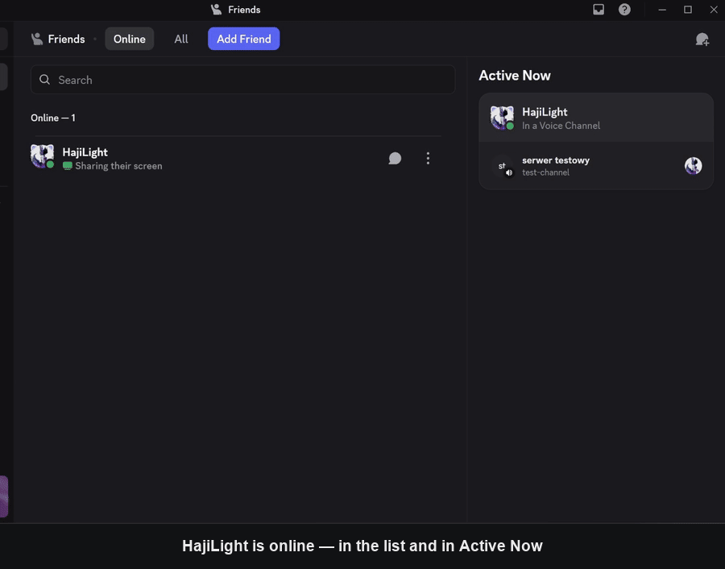

# HideSelectedFriends

[](https://github.com/HajiLight/hide-selected-friends/actions/workflows/ci.yml)
[](LICENSE)

A [Vencord](https://vencord.dev) userplugin that hides selected friends from the **Online** tab of the friends list and from the **Active Now** panel.

You remain friends. Nothing is blocked, modified on Discord's servers, or sent over the network — it filters local rendering at the data layer before rows or cards reach the UI.

## Demo



A two-account setup, cropped so that the only other person in the frame is the demo account: with
`hideInActiveNow` his card disappears from Active Now, with `hideInOnlineTab` his row disappears from
the Online list, and turning both off brings him back. The second half shows the settings — the
`hiddenUsers` field and the two toggles.

## How it filters

| Surface | Target | Effect |
| --- | --- | --- |
| **Friends → Online** | Friends list store's `filter(section, query)` | Drops hidden IDs before rendering so the list, search, and `Online — N` badge stay consistent |
| **Home → Active Now** | `NowPlayingViewStore.nowPlayingCards` getter | Drops any card containing a hidden ID (group cards disappear as a whole) |
| **Live refresh** | `useMemo` dependencies + `RelationshipStore.emitChange()` + `SettingsStore` | The friends list updates on the next render without switching tabs; Active Now updates when its store next emits |

Users are matched by **ID only** (names change, IDs do not). Anchors are module patterns verified against Discord Stable `1.0.9269`; one keys on the `NowPlayingViewStore` literal.

## Install

Requires Node.js 22+, pnpm, Git, and Vencord built from source (userplugins are compiled into Vencord's bundle):

```bash
git clone https://github.com/Vendicated/Vencord.git
cd Vencord
pnpm install --frozen-lockfile
git clone https://github.com/HajiLight/hide-selected-friends.git src/userplugins/hideSelectedFriends
pnpm build
pnpm inject
```

1. Quit Discord completely (including the system tray) and start it again.
2. Enable **HideSelectedFriends** in **Settings → Vencord → Plugins**.
3. For **Vesktop**, skip `pnpm inject`, point **Vesktop Settings → Developer Settings → Vencord Location** at Vencord's `dist` folder, then fully restart Vesktop.


## Configuration

Enable **Settings → Advanced → Developer Mode**, right-click a user, and choose **Copy User ID**.

| Setting | Default | Description |
| --- | --- | --- |
| `hiddenUsers` | empty | 15–20 digit user IDs or `<@id>` / `<@!id>` mentions, separated by newlines, spaces, commas, or semicolons; anything else is ignored |
| `hideInOnlineTab` | `true` | Hide matching users in the **Online** tab |
| `hideInActiveNow` | `true` | Hide matching users' cards in **Active Now** |

## Limitations & scope

Hiding is purely cosmetic inside this client:

- **Unfiltered surfaces:** hidden friends still appear in **DM / Group DM sidebars**, **All / Pending / Blocked** tabs, **voice channels**, **server member lists**, **Quick Switcher (`Ctrl+K`)**, **`@` mentions**, the **in-game overlay**, other devices, and raw Discord Flux stores (`RelationshipStore.isFriend`, etc.).
- **First-time enable:** Vencord only injects patches at startup for enabled plugins. Toggling **HideSelectedFriends** off/on at runtime works immediately if it was already loaded at startup; enabling it for the first time requires restarting Discord.

## Troubleshooting

| Symptom | Cause / Fix |
| --- | --- |
| Plugin missing from Vencord list | Rebuild Vencord (`pnpm build`) and restart Discord completely |
| `Patch by HideSelectedFriends had no effect` in console | Discord changed the module; open an issue with `GLOBAL_ENV.BUILD_NUMBER` from `Ctrl+Shift+I` |
| Plugin enabled, user still visible | Verify the numeric User ID (15–20 digits, not a username), ensure the user is on a filtered surface, and restart Discord if this was the first enable |

## Development

```bash
pnpm install
node scripts/dev.mjs              # copy sources into Vencord ($VENCORD_DIR, ./.vencord, ../Vencord, ../vencord/Vencord)
node scripts/dev.mjs --build      # copy, build, and verify HideSelectedFriends is in dist/renderer.js
pnpm check                        # type check (skipped cleanly if Vencord is absent) + unit tests
pnpm exec vitest run --coverage   # run Vitest with V8 coverage
```

## Project

- [Security policy](SECURITY.md)
- [Contributing](CONTRIBUTING.md)
- [Changelog](CHANGELOG.md) — every released version
- [Releases](https://github.com/HajiLight/hide-selected-friends/releases) — release notes and downloads
- [Issues](https://github.com/HajiLight/hide-selected-friends/issues) — bug reports and feature requests

## License

[GPL-3.0-or-later](LICENSE), matching Vencord. Not affiliated with Discord Inc. or Vencord; client modifications violate Discord's Terms of Service — use at your own risk.
